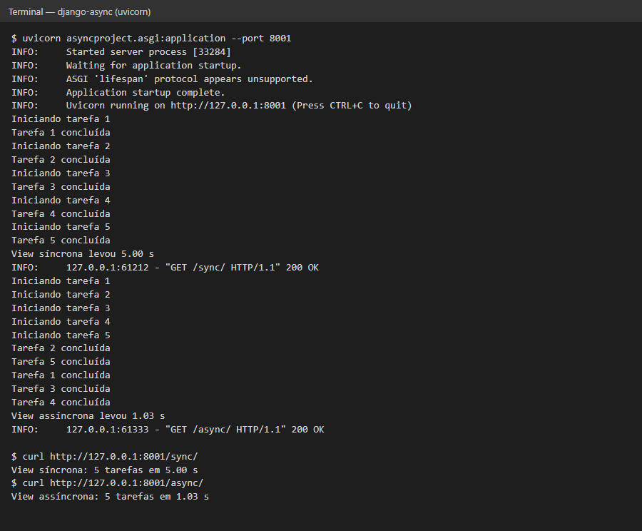

# django-async

View assíncrona em Django (suporte nativo a async desde o Django 3.1), do curso Profissão: Desenvolvedor Full Stack Python da EBAC.

**Autor:** Adryan Szenczuk

## O que tem

- `/sync/`: view tradicional, roda 5 tarefas de 1 s uma depois da outra (~5 s).
- `/async/`: view assíncrona (`async def`), roda as mesmas 5 tarefas com `asyncio.gather` e `await asyncio.sleep` (~1 s).

Cada tarefa faz um `print` no terminal, então dá para ver a diferença: na view assíncrona todas começam juntas.

## Como rodar

```bash
python -m venv .venv
.venv\Scripts\activate
pip install -r requirements.txt
uvicorn asyncproject.asgi:application --port 8001
```

Depois acesse http://127.0.0.1:8001/sync/ e http://127.0.0.1:8001/async/ e veja o terminal.
Testes: `pytest`.


